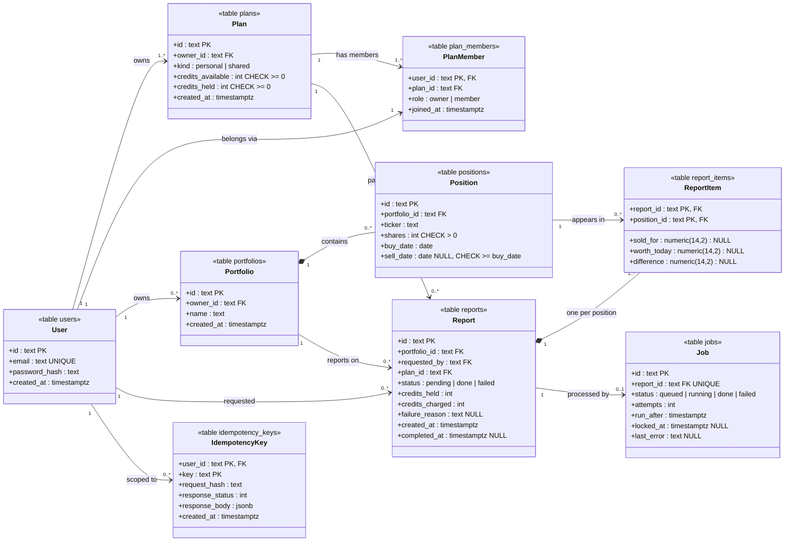
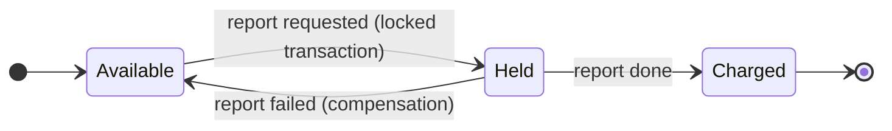

# Data model

Status: **accepted**, implemented by migration `001_initial_schema` (`backend/migrations/versions/`).
Database: PostgreSQL 18. IDs are opaque random strings with a type prefix (`us_`, `pl_`, `pf_`, `ps_`, `rp_`, `jb_`).

## UML class diagram

Each class is a table. `PK` = primary key, `FK` = foreign key. Numbers on the lines are multiplicities.

## Key rules (enforced by the database, not only by the code)

| Rule | How |
|---|---|
| A plan's credits can never go negative | `CHECK (credits_available >= 0)`, `CHECK (credits_held >= 0)` |
| A user belongs to exactly one plan at a time | `plan_members.user_id` is the primary key |
| Each user has exactly one personal plan | Unique index on `plans(owner_id) WHERE kind = 'personal'` |
| Shares are whole and positive; a sale can't be before the buy | `CHECK (shares > 0)`, `CHECK (sell_date IS NULL OR sell_date >= buy_date)` |
| An Idempotency-Key is private to the user who sent it | Primary key `(user_id, key)` |
| A report has at most one job | `UNIQUE (report_id)` on `jobs` |
| Status values are only the allowed ones | `CHECK (status IN (...))` on `reports` and `jobs` |

## Design decisions

| Decision | Why | Source |
|---|---|---|
| Credits live on the `plans` row | That row is the contended resource; requesting a report locks it with `SELECT ... FOR UPDATE` | Proposal §5, Ch7 |
| `CHECK` constraints on credits | Defense in depth: even with a bug in the code, PostgreSQL refuses an oversell | Book Ch6 p.90 |
| `plan_members` keyed by user | Removing a member moves them back to their personal plan; they never belong to two plans | Proposal §2, §7 |
| Idempotency keys scoped per user | Two users with the same key never see each other's responses | Ch3 notes p.2, 4; Book p.83-84 |
| Money as `numeric(14,2)` | Exact decimals, never floats | Contract (`Money` as string) |
| `jobs` table in the first migration | Holding credits and queueing the job happen in one transaction (outbox) | Proposal §6, Ch9 |
| Random prefixed IDs | Counters are guessable; random IDs plus 404-for-not-yours stops ID probing | Ch2 slides p.6 |

## Credit flow on one plan

## Migrations

| # | Name | Contents |
|---|---|---|
| 001 | `initial_schema` | All tables above |
| 002 | `report_dividends` | `reports.include_dividends` (backward-compatible contract change) |
| 003 | `price_cache` | Cached closes and split events (after the milestone) |
